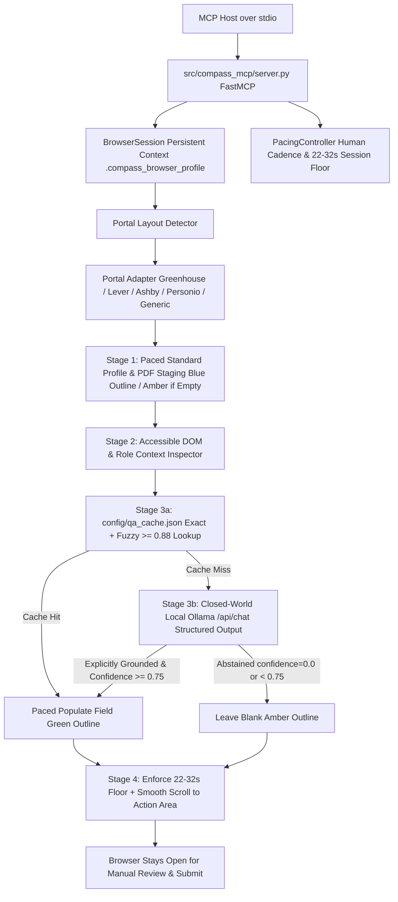

# Career Compass MCP — Implementation Plan

## Overview

`career-compass-mcp` is a privacy-first **Interactive Web Form Accessibility & Prefill Assistant** built as a Python **Model Context Protocol (MCP) Server** (`FastMCP`). It opens a user-provided application URL in a persistent **headed Playwright browser context** (`headless=False`, `.compass_browser_profile`), populates standard profile fields and attaches PDF documents from local configuration (`config/profile.yaml`) using human-cadence interaction pacing (`PacingController`), maps custom questions through a fuzzy-matching local cache (`config/qa_cache.json`) and a **closed-world grounded local Ollama** model (`httpx` -> `http://localhost:11434/api/chat`), and applies **non-intrusive inline CSS outline highlights** so the user remains in full control and clicks submit manually.

---

## 1. Architecture & 4-Stage Workflow



### Stage-by-Stage Data Flow (`stage_form_session`)
1. **Standard Profile Staging:**
   - Start `PacingController(min_session_seconds=...)` tracking `session_start = time.monotonic()`.
   - Load `UserProfile` from `config/profile.yaml` and cached answers from `config/qa_cache.json`.
   - Start or reuse the singleton headed Chromium persistent context (`user_data_dir=".compass_browser_profile"`) via `BrowserSession` and navigate to `url`.
   - Detect the portal layout (`greenhouse`, `lever`, `ashby`, `personio`, or `generic`) and switch to `#grnhse_iframe` when embedded.
   - Populate standard fields (Full/First/Last Name, Email, Phone, Location, LinkedIn, GitHub, Portfolio) via `PacingController.paced_fill` and attach local PDFs (`resume.pdf`, `cover_letter.pdf`).
   - Apply **Blue** (`#2563eb`) inline CSS outline (`element.style.outline = "2px solid #2563eb"`, `element.style.outlineOffset = "2px"`) and native `title` metadata to populated standard profile fields. If a standard profile field (such as `phone`, `portfolio`, `notice_period`, `availability_date`, or `salary_expectations`) is empty in `profile.yaml` and not in `qa_cache.json`, leave it blank and highlight in **Amber** (`#d97706`) so the user is prompted to provide or cache it.
2. **Accessible DOM Schema Extraction:**
   - Extract visible role description text from the page (capped to ~8,000 characters) to ground open-ended responses.
   - Inspect all remaining visible, enabled, unfilled controls (`text`, `textarea`, `select`, `radio`, `checkbox`, `combobox`, `numeric`, `date`), resolving each control's accessible label (`<label for>`, parent `<label>`, `aria-label`, `aria-labelledby`, or `fieldset legend`) and available options.
3. **Local Ollama Context Mapping, Strict Closed-World Grounding & Memory Cache:**
   - Normalize each control prompt and check `config/qa_cache.json` using both exact normalized lookup and `difflib.SequenceMatcher` fuzzy matching (threshold `>= 0.88`).
   - On cache miss, query `POST {OLLAMA_BASE_URL}/api/chat` with `stream=False` and `format=FieldSuggestion.model_json_schema()`:
     - **Strict Zero-Hallucination & Closed-World Abstention Rule:** `config/profile.yaml` and `config/qa_cache.json` are the **only** source of truth. If a control asks about a skill, tool, domain, certification, security clearance, language level, notice period, salary expectation, phone number, or demographic question NOT explicitly present in `profile.yaml` or `qa_cache.json`, the assistant MUST NOT guess or assume `"Yes"`. It must return `confidence: 0.0`, `value: ""`, and `reasoning: "Fact not explicitly present in profile.yaml — flagged for manual user input"`.
     - **Mode 1 (Structured Controls):** `temperature=0.0`, selects exact option from `control.options` only when explicitly supported by `profile.yaml`, caches answer when `confidence >= 0.85`.
     - **Mode 2 (Open-Ended Textareas):** `temperature=0.35`, grounded strictly in `profile.yaml` (Synechron/Wells Fargo AI governance & LLM-as-a-Judge platform, Innovapath/Optum 9-agent Google ADK contract pipeline, Atlantis University TalentScreen RAG/multi-agent platform, Wipro MLOps, INNOVAPATH IT Solutions) + role context + `extra_notes`, enforcing the direct human engineer style and post-processing sanitation (2–4 sentences, 40–75 words, banned cliche filter, no em-dashes/semicolons/bullets).
4. **HITL Visual Review Overlay & Natural Session Pacing:**
   - Populate suggestions with `confidence >= 0.75` using `PacingController` and highlight in **Green** (`#16a34a`) via inline `style.outline` and `title`.
   - Leave controls with `confidence < 0.75` (including all abstained `confidence == 0.0` fields and consent checkboxes) blank and highlight in **Amber** (`#d97706`) via inline `style.outline` and `title` (never injecting foreign HTML banner nodes that could break React hydration or strict CSP).
   - Enforce the configurable minimum session duration (`CAREER_COMPASS_MIN_SESSION_SECONDS=25`, randomized window `22.0s–32.0s`) with smooth incremental viewport scrolling to the final action area, and **keep the browser open** without ever clicking submit.

---

## 2. Target Directory & Module Design

```text
career-compass-mcp/
├── .cursorrules
├── .env.example
├── .gitignore
├── implementation_plan.md
├── pyproject.toml
├── README.md
├── config/
│   ├── profile.yaml           # Local user profile (Ramana Gangarao exact factual profile)
│   └── qa_cache.json          # Local memory cache of previously answered form prompts
├── assets/
│   └── .gitkeep               # Directory for user PDF documents (resume.pdf, cover_letter.pdf)
├── src/
│   └── compass_mcp/
│       ├── __init__.py
│       ├── server.py          # FastMCP server entrypoint & 4 assistive MCP tools
│       ├── models.py          # Pydantic v2 schemas (UserProfile, FormControl, FieldSuggestion, SessionReport)
│       ├── config_loader.py   # YAML profile & JSON cache reader/writer with fuzzy matching
│       ├── browser/
│       │   ├── __init__.py
│       │   ├── session.py     # Singleton persistent async Playwright BrowserContext/Page (.compass_browser_profile)
│       │   ├── pacing.py      # PacingController: paced_fill, inter_field_delay, 22-32s session floor
│       │   └── dom_inspector.py # Inspects accessible form labels, inputs, and page context
│       ├── adapters/
│       │   ├── __init__.py
│       │   ├── base.py        # Abstract BasePortalAdapter class + inline style highlight helpers
│       │   ├── greenhouse.py  # Classic (#grnhse_iframe) + Modern React-Select (job-boards.greenhouse.io)
│       │   ├── lever.py       # Standard selectors + document upload settle handling
│       │   ├── ashby.py       # React-controlled input & aria-combobox helpers
│       │   └── personio.py    # Standard EU portal form tabs & document category dropzones
│       └── llm/
│           ├── __init__.py
│           └── assistant.py   # Closed-world Local Ollama client with Two-Mode routing & Natural Writing Style
└── tests/
    └── test_layout_detection.py
```

### Module Breakdown

#### A. Schemas & Local Storage (`src/compass_mcp/models.py`, `src/compass_mcp/config_loader.py`)
- **`models.py` (Pydantic v2):**
  - `UserProfile` aligned cleanly with `config/profile.yaml`:
    - `personal`: `first_name`, `last_name`, `full_name`, `email`, `phone`, `location`, `city`, `state`, `country`
    - `links`: `linkedin`, `github`, `portfolio`, `website` (automatically sanitizes markdown link syntax like `[url](url)` into clean URLs)
    - `documents`: `resume_path`, `cover_letter_path`
    - `work_authorization`: `current_location`, `authorized_india`, `authorized_eu`, `authorized_us`, `requires_eu_visa_sponsorship`, `requires_us_visa_sponsorship`, `willing_to_relocate_eu_germany`
    - `preferences`: `target_roles: list[str]`, `remote_preference`, `relocation`, `notice_period`, `availability_date`, `salary_expectations`
    - `education: list[EducationEntry]` (`degree`, `institution`, `location`, `graduation_date`)
    - `certifications: list[str]`
    - `languages: list[LanguageEntry]` (`language`, `proficiency`)
    - `experience`: `years_of_experience`, `current_title`, `current_company`, `summary`, `core_skills: list[str]`, `highlights: list[ExperienceHighlight]` (`role`, `company`, `location`, `period`, `details`)
- **`config_loader.py`:**
  - `load_user_profile() -> UserProfile` reads and validates `config/profile.yaml`.
  - `QACacheManager` normalizes prompt labels (`lowercase`, stripped punctuation, collapsed whitespace), checks for an exact normalized match first, and falls back to `difflib.SequenceMatcher` fuzzy matching (`ratio >= 0.88`) before calling Ollama.

#### B. Persistent Browser, PacingController & Accessible DOM Inspector (`src/compass_mcp/browser/`)
- **`session.py` (`BrowserSession`):**
  - Uses `playwright.chromium.launch_persistent_context(user_data_dir=".compass_browser_profile", headless=False, no_viewport=True, args=["--disable-blink-features=AutomationControlled"])`.
- **`pacing.py` (`PacingController`):**
  - Tracks `session_start = time.monotonic()` and enforces a randomized `22.0s–32.0s` minimum session floor (`CAREER_COMPASS_MIN_SESSION_SECONDS=25`).
  - `paced_fill(locator, text)`: smooth scroll (`0.3s–0.7s` pause) -> click focus (`0.2s–0.4s` pause) -> `.press_sequentially(text, delay=random.randint(35, 85))` with `0.15s` pauses at spaces/punctuation -> `inter_field_delay` (`0.8s–1.8s`).

#### C. Portal Layout Adapters (`src/compass_mcp/adapters/`)
- **`base.py` (`BasePortalAdapter`):**
  - **Non-Intrusive DOM Highlighting:** Applies visual status strictly via inline CSS styles on existing form controls (`element.style.outline = "2px solid <hex>"`, `element.style.outlineOffset = "2px"`, `element.title = tooltip`, and `element.dataset.compassStaged = color`) without injecting foreign HTML banner nodes.
  - **Empty Profile Value Handling:** If a standard field (e.g., `phone`, `portfolio`, `website`) is empty `""` in `profile.yaml`, the adapter does not fill dummy data; if the control is present on the page and not in `qa_cache.json`, it remains unfilled and gets highlighted in **Amber** (`#d97706`).
  - **Submit Denylist Guard:** Blocks any `.click()` on `input[type="submit"]`, `button[type="submit"]`, or final submit buttons.
- **`greenhouse.py` (`GreenhouseAdapter`):**
  - Supports both classic `#grnhse_iframe` (`boards.greenhouse.io`) and modern React-Select `job-boards.greenhouse.io` (`#candidate-location` and `input[role="combobox"]` -> type value -> wait 600ms for `[role="option"]` -> click matching option).
- **`lever.py` (`LeverAdapter`):**
  - Attaches `#resume-upload-input` first and waits for Lever's file parser to settle before populating text fields via `paced_fill`.
- **`ashby.py` (`AshbyAdapter`):**
  - Uses `paced_fill` and `role="combobox"` listbox option selection so React `onChange` state updates cleanly.
- **`personio.py` (`PersonioAdapter`):**
  - Supports multi-tab EU portal layouts, compensation/notice period inputs (consulting `qa_cache.json` first and flagging Amber when empty in `profile.yaml`), and categorized document dropzones.

#### D. Local Ollama Assistant (`src/compass_mcp/llm/assistant.py`)
- Uses `httpx.AsyncClient` against `OLLAMA_BASE_URL` (`http://localhost:11434`) and `OLLAMA_MODEL` (`qwen2.5-coder:7b`) with `format=FieldSuggestion.model_json_schema()`.
- **Deterministic Closed-World Pre-Check & Prompt Guardrails:**
  - Before or after querying Ollama, checks if the prompt asks for a missing profile attribute (e.g., phone number when `personal.phone == ""`, notice period when `preferences.notice_period == ""`, salary expectation when `preferences.salary_expectations == ""`, availability date when `preferences.availability_date == ""`, demographic/EEOC/veteran/disability questions, or unverified skills/clearances) and immediately abstains with `confidence=0.0, value="", reasoning="Fact not explicitly present in profile.yaml — flagged for manual user input"`.
  - Mode 1 (`temperature: 0.0`) for structured controls; caches answers with `confidence >= 0.85`.
  - Mode 2 (`temperature: 0.35`) for open-ended textareas; grounds strictly in Ramana Gangarao's documented experience (Synechron/Wells Fargo, Innovapath/Optum, Atlantis University, Wipro, INNOVAPATH IT Solutions) and enforces the natural engineer writing style (2–4 sentences, 40–75 words, no banned cliches, no em-dashes/semicolons/bullets).

#### E. FastMCP Server & 4 Assistive Tools (`src/compass_mcp/server.py`)
- Exposes `stage_form_session`, `list_unfilled_controls`, `update_form_control`, and `close_session`.
